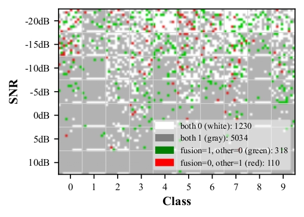

<h1 align="center">Harmony in Time and Frequency: Lightweight Spectro-Temporal Disentanglement for UAV RF Fingerprinting</h1>

<div align="center">

[Zhenkun Liu](https://github.com/lzk2211),
[Yunling Liao](https://github.com/FishSkin2002),
[Zhiyv Dai](https://github.com/krismiledy) and 
[JunSheng Mu](https://scholar.google.com/citations?hl=zh-CN&user=ikS5u98AAAAJ)

Beijing University of Posts & Telecommunications.

[](./LICENSE)
[](#installation)
[](#installation)
[](https://github.com/lzk2211/SRSpecNet)

</div>

<div align="center">
  <a href="graph/mothed.pdf" target="_blank">
    
  </a>
  <br>
  <p>click <a href="graph/mothed.pdf">here</a> to see the PDF</p>
</div>

## 📣 News

- [06/Nov/2025] Initial public release of SRSpecNet repository.
- [20/Nov/2025] Complete the experiments for the proposed innovations, design rigorous comparative experiments, and begin preparing figures for this paper.
- [04/Dec/2025] The main body of the paper is essentially complete. Detailed updates have been made to the GitHub repository.
<!-- - [xx/xxx/2025] Paper preprint and model weights to be released soon.
- [xx/xxx/2025] Benchmark scripts and dataset preparation utilities added. -->

## 📝 Abstract(Updating)

Radio Frequency (RF) fingerprinting is a promising technique for Unmanned Aerial Vehicle (UAV) identification. However, existing methods often struggle to balance recognition accuracy with computational efficiency, especially under low Signal-to-Noise Ratio (SNR) conditions.

This paper proposes **H-starNet**, a lightweight **H**armonic-aware **S**pectro-**T**emporal **A**ttention **R**esidual **Net**work. Our approach disentangles the RF signals into two complementary domains:

- **Spectral Branch (HARNet)**: Captures stationary frequency fingerprints (e.g., filter shapes) using a Multi-Resolution Frequency Sparse Module (MRFSM).
- **Temporal Branch (SSTA)**: Captures dynamic temporal patterns (e.g., hopping sequences) using Sparse Sub-band Temporal Attention.

Coupled with a **Gated Cross-Domain** Fusion mechanism and a **Deep Supervision** training strategy, H-starNet achieves state-of-the-art accuracy with significantly lower computational costs compared to traditional CNNs and Transformers.

## 🏗️ Framework

The overall architecture of H-starNet consists of three main stages:

<div align="center">
  <a href="graph/nn.pdf" target="_blank">
    
  </a>
  <br>
  <p>click <a href="graph/nn.pdf">here</a> to see the PDF</p>
</div>

- **HARNet (Spectral Branch)**: Extracts time-averaged PSD features using multi-dilation convolutions to capture micro-scale and macro-scale spectral details.
- **SSTA (Temporal Branch)**: Utilizes local average pooling and grouped self-attention with relative position bias to model long-range temporal dependencies (e.g., OFDM symbol periodicity, FHSS hopping).
- **Gated Fusion & Deep Supervision**: Uses robust spectral features to guide temporal activation and employs multi-loss optimization (Main + Aux + Orthogonal) to ensure feature complementarity.

📂 Dataset

We use the **[DroneRFa](https://jeit.ac.cn/cn/article/doi/10.11999/JEIT230570)** dataset for evaluation.

- **Signals**: Raw I/Q signals collected via USRP.
- **Preprocessing**: Signals are sliced into 50ms segments and transformed into **512x512 Spectrograms** via STFT.
- **Categories**: 10 classes (9 Commercial UAVs + 1 Background Noise).

**Data Structure**

Please organize the dataset as follows:

```bash
data_set_5e6/
├── T0000/
├── T0001/
├── T0010/
├── ...
└── T1001/
```

## 🛠️ Installation

1. Clone the repository:
```bash
git clone [https://github.com/lzk2211/SRSpecNet.git](https://github.com/lzk2211/SRSpecNet.git)
cd SRSpecNet
```
2. Install dependencies:
```bash
conda install pytorch==2.4.0 torchvision==0.19.0 torchaudio==2.4.0 pytorch-cuda=12.4 -c pytorch -c nvidia
pip install -r requirements.txt
```

## 🚀 Usage

The main entry point is main.py. You can switch between training and testing modes using command line arguments.

**Training**

To train the **H-starNet (Small version)** with Multi-Loss Deep Supervision:

```bash
python main.py \
  --mode Train \
  --model F_T_small_mulitloss_1122 \
  --exp_name F_T_small_mulitloss_1122 \
  --root_path /path/to/your/data_set_5e6 \
  --batch_size 64 \
  --epochs 250 \
  --lr 0.0001 \
  --seed 42
```

Key Arguments:

- `--model`: The model factory function name (e.g., F_T for fusion model).
- `--exp_name`: The runing results save in this project.
- `--root_path`: Path to the preprocessed spectrogram dataset.

## 📊 Results

Performance comparison on DroneRFa dataset (Avg Accuracy vs. Efficiency):

### Comprehensive Analysis: Ablation Study & Performance Comparison (Small Scale Focus)

**Table Caption:** Part I details the impact of specific modules on the Small architecture relative to the baseline. Part II compares our final models against state-of-the-art methods. MEI is calculated as $Acc / \log(Params \times MACs)$.

| Model / Configuration | Avg Acc (%) | Params (M) | MACs (M) | MEI (Score) | GPU Infer. Time (s) | CPU Infer. Time (s) | Memory (MB) | Train Cost (GPU/h) |
| :--- | :---: | :---: | :---: | :---: | :---: | :---: | :---: | :---: |
| **Part I: Module Ablation Study** | | | | | | | | |
| *1. HARNet Architecture* | | | | | | | | |
| Baseline | 69.43 | 0.019 | 0.59 | 6.90 | 4.68 | 6.49 | 1.21 | 0.62 |
| w/ SE Block | 70.29 (+0.86%) | 0.031 | 0.68 | 6.81 (-1.30%) | 4.56 | 6.44 | 1.21 | 0.60 |
| w/ MRFSM | 72.53 (+3.10%) | 0.019 | 0.59 | **7.21** (+4.49%) | 4.62 | 6.87 | 1.20 | 0.76 |
| **HARNet (Ours)** | **77.81** (+8.38%) | 0.111 | 2.01 | 6.86 (-0.58%) | 4.54 | 7.13 | 1.29 | 0.60 |
| *2. SSTA Architecture* | | | | | | | | |
| Baseline | 74.18 | 0.550 | 273.70 | 5.23 | 3.66 | 19.63 | 7.44 | 0.95 |
| Abs. Pos. Enc. | 30.81 (-43.37%) | 0.042 | 1.75 | 2.83 (-45.89%) | 4.76 | 21.74 | 1.78 | 0.45 |
| w/ Stem | 74.33 (+0.15%) | 0.550 | 34.26 | 5.60 (+7.07%) | 4.55 | 7.69 | 1.93 | 0.78 |
| w/ Grouped | 75.21 (+1.03%) | 0.042 | 13.65 | 6.40 (+22.37%) | 7.06 | 287.63 | 6.86 | 3.19 |
| **SSTA (Ours)** | **75.79** (+1.61%) | 0.042 | 1.75 | **6.97** (+33.27%) | 4.52 | 14.91 | 1.79 | 0.37 |
| *3. H-starNet (Fusion) Architecture* | | | | | | | | |
| Baseline | 78.89 | 0.144 | 3.75 | 6.72 | 4.81 | 19.02 | 1.80 | 0.73 |
| w/ Gating Mechanism | 80.41 (+1.52%) | 0.177 | 3.79 | 6.80 (+1.19%) | 4.71 | 27.16 | 1.80 | 0.72 |
| w/ Multi-Loss | 79.32 (+0.43%) | 0.154 | 3.76 | 6.74 (+0.30%) | 4.72 | 17.18 | 1.93 | 1.38 |
| **H-starNet (Ours)** | **81.44** (+2.55%) | 0.188 | 3.80 | **6.87** (+2.23%) | 3.65 | 19.12 | 1.80 | 1.07 |
| **Part II: Benchmark Comparison** | | | | | | | | |
| *Comparison Methods* | | | | | | | | |
| MobileNetV3-Small | 77.36 | 0.930 | 316.03 | 5.35 | 5.67 | - | 14.19 | - |
| ResNet18 | 76.11 | 11.180 | 9115.93 | 4.48 | 15.21 | - | 34.59 | - |
| 1D-LW-ResNet18 | 73.92 | 0.135 | 3.54 | 6.33 | 3.51 | 7.22 | 1.29 | - |
| S3R | 72.04 | 34.530 | 547.85 | 4.43 | 10.93 | - | 11.26 | - |

## 🔬 Analysis & Visualization

To investigate the internal working mechanism of H-starNet, we provide detailed visualizations of feature activation and error distribution.

### 1. Class Activation Mapping (CAM)

We utilize CAM to visualize the regions of interest for different network branches.

<div align="center">
  <a href="graph/result.pdf" target="_blank">
    
  </a>
  <br>
  <p>click <a href="graph/result.pdf">here</a> to see the PDF</p>
</div>

- **HARNet**: Displays distinct horizontal stripe patterns, indicating its focus on positional information of critical frequency blocks.

- **SSTA**: Leverages global temporal correlations to produce precise masks covering all relevant frequency blocks (e.g., VTS and FCS signals), demonstrating superior noise resistance.

- **2D-CNN**: Tends to perceive frequency blocks as a single holistic object, lacking signal-specific refinement compared to our specialized branches.

### 2. Mosaic Error Analysis

To validate the synergistic effect of the dual-branch fusion, we conducted a detailed error analysis using mosaic plots. Green pixels indicate samples where the fused model corrected the error of a single branch.

<div align="center">
<table>
<tr>
<td style="text-align:center">


<b>(a) Fusion vs. HARNet Branch</b>
</td>
<td style="text-align:center">


<b>(b) Fusion vs. SSTA Branch</b>
</td>
</tr>
</table>
</div>

- **Fig (a)**: H-starNet compensates for HARNet's deficiencies in **lower SNR regions** (dense green points), proving that temporal features are crucial when spectral features are corrupted by noise.

- **Fig (b)**: While SSTA may perform suboptimally at high SNRs, the fused model maintains high accuracy by leveraging HARNet. In **low-SNR conditions**, H-starNet effectively exploits SSTA's robust global correlation features to ensure stability.

**Conclusion**: The fusion mechanism successfully synthesizes the distinct advantages of both architectures, achieving consistent and robust performance across the entire SNR spectrum.


## 🔗 Citation

If you find this work useful for your research, please consider citing:

```bibtex
@article{liu2025harmony,
  title={Harmony in Time and Frequency: Lightweight Spectro-Temporal Disentanglement for UAV RF Fingerprinting},
  author={Liu, Zhenkun and Liao, Yunling and Dai, Zhiyv and Mu, JunSheng},
  journal={arXiv preprint},
  year={2025}
}
```
## License

This repository is under the [Apache-2.0 license](./LICENSE).
