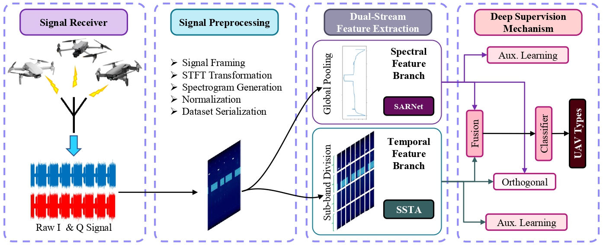
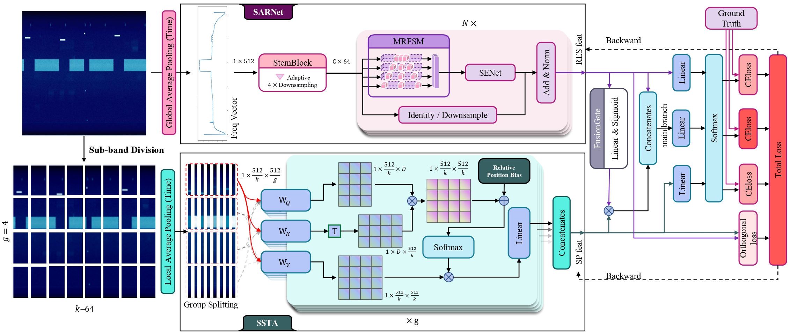
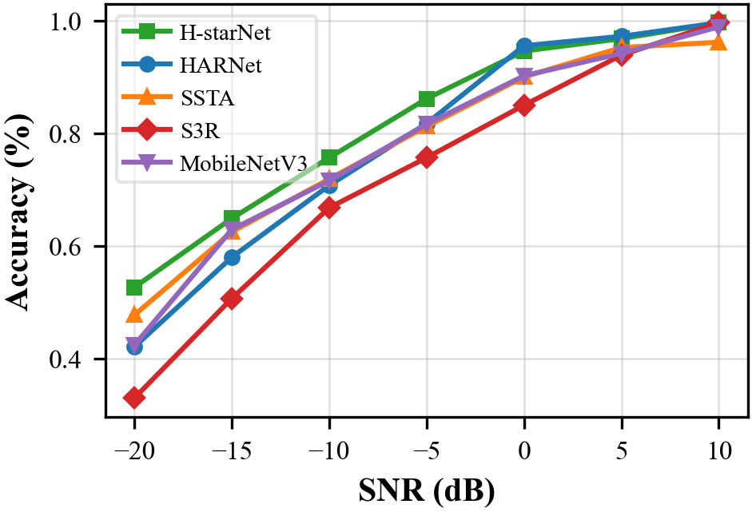
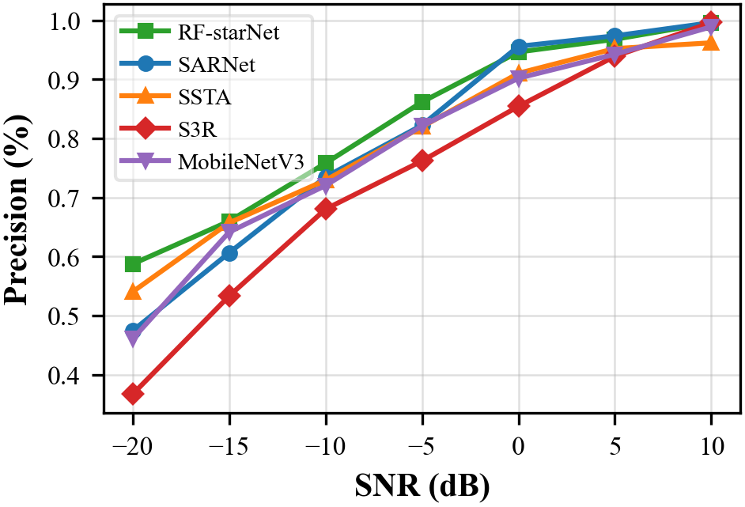
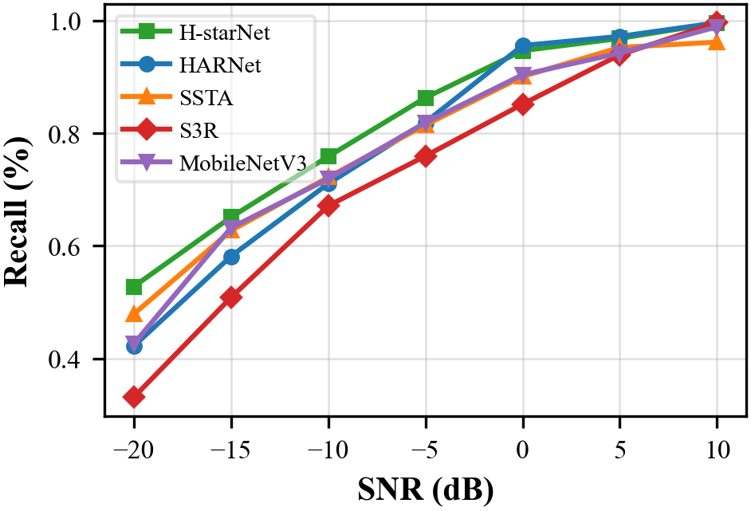
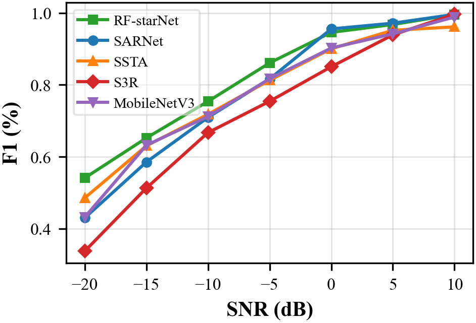
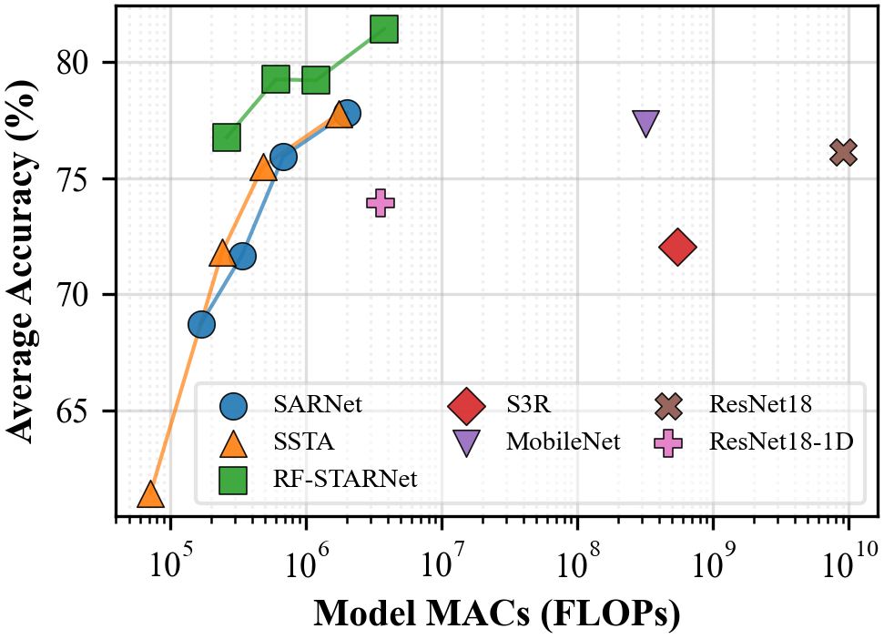
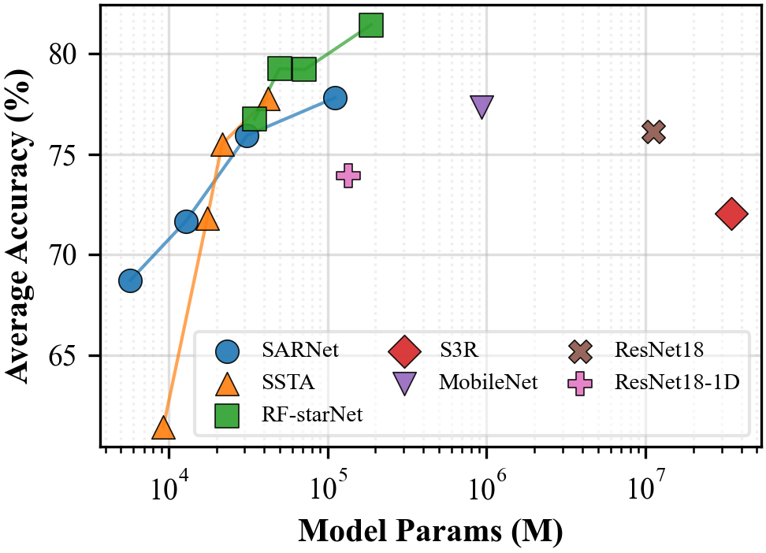
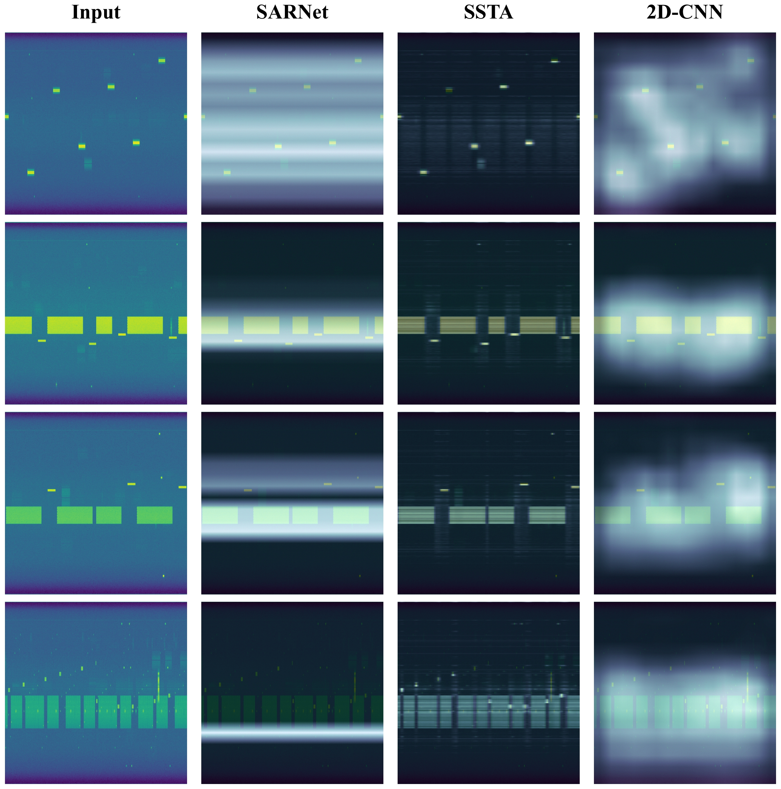
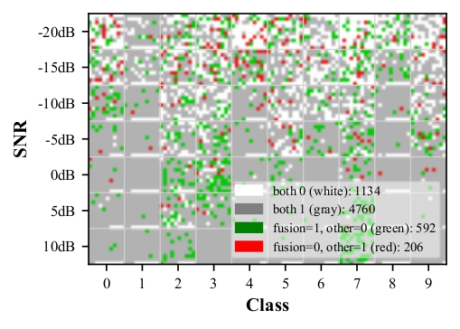

<h1 align="center">
  
</h1>

<div align="center">

[Zhenkun Liu](https://github.com/lzk2211),
[Yunling Liao](https://github.com/FishSkin2002),
[Zhiyv Dai](https://github.com/krismiledy) and 
[JunSheng Mu](https://scholar.google.com/citations?hl=zh-CN&user=ikS5u98AAAAJ)
(Provisional)

Beijing University of Posts & Telecommunications.

[](./LICENSE)
[](#installation)
[](#installation)
[](#installation)
[](https://github.com/lzk2211/RF-STARNet)

</div>

<div align="center">
  <a href="graph/methodologies.pdf" target="_blank">
    
  </a>
  <br>
  <p>click <a href="graph/methodologies.pdf">here</a> to see the PDF</p>
</div>

## 📄 文档概要

- 介绍了 RF-STARNet：一种针对无人机射频指纹识别的轻量化双分支（频谱 SARNet + 时域 SSTA）网络，并配有融合与多重监督策略。
- 概述了所用 DroneRFa 数据集的组织形式与预处理方法（50ms 信号切片、512×512 频谱图）。
- 给出了环境依赖的安装方式，以及使用 `main.py` 进行训练/测试的基本命令行参数。
- 总结了在精度、计算量、推理速度等方面的实验结果与消融研究，并展示了可视化分析（类激活映射 CAM、误差马赛克图）。

## 📣 News

- [06/Nov/2025] Initial public release of RF-STARNet repository.
- [20/Nov/2025] Complete the experiments for the proposed innovations, design rigorous comparative experiments, and begin preparing figures for this paper.
- [04/Dec/2025] The main body of the paper is essentially complete. Detailed updates have been made to the GitHub repository.
<!-- - [xx/xxx/2025] Paper preprint and model weights to be released soon.
- [xx/xxx/2025] Benchmark scripts and dataset preparation utilities added. -->

## 📝 Abstract(Updating)

With the rapid increase of Low-Altitude Wireless Networks (LAWN), the effective management and regulation of Unmanned Aerial Vehicles (UAVs) have become critically important. Radio Frequency (RF) fingerprinting has emerged as a key technology for UAV detection, witnessing a paradigm shift from traditional model-driven approaches to data-driven deep learning methods. 
However, existing methods fall short of the efficiency required for agile deployment. They treat RF signal or spectrograms as generic sequences or images, thereby overlooking the unique stationary behaviors inherent in the signals. Instead, they tend to over-learn massive dynamic redundant features, which consequently limits identification performance and increase model complexity.
To address these, we propose a lightweight **R**adio-**F**requency **S**pectro-**T**emporal **A**ttention **R**esidual **Net**work (**RF-STARNet**), which leverages dual-stream spectro-temporal learning to extract structured features for efficient detection. Specifically, we design a Spectral-Aware Residual Network (**SARNet**) to extract sparse, stationary spectral patterns. Simultaneously, a Sparse Sub-band Temporal Attention (**SSTA**) mechanism is used to capture global temporal autocorrelations and cyclostationary features.
To deeply integrate these heterogeneous features, we propose an Adaptive Gating Mechanism to dynamically calibrate branch contributions, augmented by a novel deep supervision strategy that enforces feature diversity to ensure the learning of complementary discriminative knowledge.
Experimental results demonstrate that RF-STARNet achieves a superior accuracy of 81.44\% with an ultra-low computational cost of 3.8 MFLOPs, exhibiting remarkable robustness even in low Signal-to-Noise Ratio (SNR) environments.
## 🏗️ Framework

The overall architecture of RF-STARNet consists of three main stages:

<div align="center">
  <a href="graph/nn.pdf" target="_blank">
    
  </a>
  <br>
  <p>click <a href="graph/nn.pdf">here</a> to see the PDF</p>
</div>

- **SARNet (Spectral Branch)**: Extracts time-averaged PSD features using multi-dilation convolutions to capture micro-scale and macro-scale spectral details.
- **SSTA (Temporal Branch)**: Utilizes local average pooling and grouped self-attention with relative position bias to model long-range temporal dependencies (e.g., OFDM symbol periodicity, FHSS hopping).
- **Gated Fusion & Deep Supervision**: Uses robust spectral features to guide temporal activation and employs multi-loss optimization (Main + Aux + Orthogonal) to ensure feature complementarity.

## 📂 Dataset

We use the **[DroneRFa](https://jeit.ac.cn/cn/article/doi/10.11999/JEIT230570)** dataset for evaluation.

- **Signals**: Raw I/Q signals collected via USRP.
- **Preprocessing**: Signals are sliced into 50ms segments and transformed into **512x512 Spectrograms** via STFT.
- **Categories**: 10 classes (9 Commercial UAVs + 1 Background Noise).

**Data Structure**

Please organize the dataset as follows:

```bash
data_set_5e6/
├── T0000/
├── T0001/
├── T0010/
├── ...
└── T1001/
```

## 🛠️ Installation

1. Clone the repository:
```bash
git clone [https://github.com/lzk2211/RF-STARNet.git](https://github.com/lzk2211/RF-STARNet.git)
cd RF-STARNet
```
2. Install dependencies:
```bash
conda install pytorch==2.4.0 torchvision==0.19.0 torchaudio==2.4.0 pytorch-cuda=12.4 -c pytorch -c nvidia
pip install -r requirements.txt
```

## 🚀 Usage

The main entry point is main.py. You can switch between training and testing modes using command line arguments.

**Training**

To train the **RF-STARNet (Small version)** with Multi-Loss Deep Supervision:

```bash
python main.py \
  --mode Train \
  --model F_T_small_mulitloss_1122 \
  --exp_name F_T_small_mulitloss_1122 \
  --root_path /path/to/your/data_set_5e6 \
  --batch_size 64 \
  --epochs 250 \
  --lr 0.0001 \
  --seed 42
```

Key Arguments:

- `--model`: The model factory function name (e.g., F_T for fusion model).
- `--exp_name`: The runing results save in this project.
- `--root_path`: Path to the preprocessed spectrogram dataset.

## 📊 Results

Performance comparison on DroneRFa dataset (Avg Accuracy vs. Efficiency)

### 1. **Performance Superiority**
The proposed dual-stream fusion network, RF-STARNet, demonstrates superior performance across all evaluation metrics compared to its individual sub-branches (SARNet and SSTA). specifically, RF-STARNet achieves an average accuracy of **81.44%**, outperforming the standalone SARNet and SSTA branches by *3.63%* and *5.65%*, respectively. This validates the effectiveness of fusing temporal and spectral features, leveraging the complementary strengths of CNN-based and Transformer-based architectures.

<div align="center">
<table>
  <tr>
    <td style="text-align:center">
      
      <br>
      <b>(a) Accuracy</b>
    </td>
    <td style="text-align:center">
      
      <br>
      <b>(b) Precision</b>
    </td>
  </tr>

  <tr>
    <td style="text-align:center">
      
      <br>
      <b>(c) Recall</b> </td>
    <td style="text-align:center">
      
      <br>
      <b>(d) F1-score</b> </td>
  </tr>
</table>
</div>

### 2. Efficiency vs. Accuracy Trade-off
The trade-off between model accuracy and computational complexity. 

Lightweight Design: RF-STARNet maintains an extremely low parameter count (**0.188 M**) and computational cost (**3.80 M MACs**). Compared to the heavyweight ResNet18 (11.18 M Params), our model reduces the model size by approximately 98% while achieving a higher accuracy (**81.44% vs. 76.11%**).

Inference Speed: The optimized architecture allows for rapid inference (**3.65s on GPU**), making it highly suitable for real-time drone detection on edge devices. The high Model Efficiency Index (**MEI = 6.87**) further confirms that RF-STARNet achieves the best balance between performance and resource consumption among all compared methods.

<div align="center">
<table>
<tr>
<td style="text-align:center">


<b>(a) The Average Accuracy vs. Computational Cost</b>
</td>
<td style="text-align:center">


<b>(b) The Average Accuracy vs. Model Size</b>
</td>
</tr>
</table>
</div>

### 3. Comprehensive Analysis: Ablation Study & Performance Comparison (Small Scale Focus)

**Table Caption:** Part I details the impact of specific modules on the Small architecture relative to the baseline. Part II compares our final models against state-of-the-art methods. MEI is calculated as $Acc / \log(Params \times MACs)$.

| Model / Configuration | Avg Acc (%) | Params (M) | MACs (M) | MEI (Score) | GPU Infer (s) | CPU Infer (s) | Memory (MB) | Train Cost (h) |
| :--- | :---: | :---: | :---: | :---: | :---: | :---: | :---: | :---: |
| **Part I: Module Ablation Study** | | | | | | | | |
| *1. SARNet Architecture* | | | | | | | | |
| Baseline | 69.43 | 0.019 | 0.59 | 6.90 | 4.68 | 6.49 | 1.21 | 0.62 |
| w/ SE Block | 70.29 <span style="color:red">(+0.86%)</span> | 0.031 | 0.68 | 6.81 <span style="color:green">(-1.30%)</span> | 4.56 | 6.44 | 1.21 | 0.60 |
| w/ MRFSM | 72.53 <span style="color:red">(+3.10%)</span> | 0.019 | 0.59 | **7.21** <span style="color:red">(+4.49%)</span> | 4.62 | 6.87 | 1.20 | 0.76 |
| **SARNet (Ours)** | **77.81** <span style="color:red">(+8.38%)</span> | 0.111 | 2.01 | 6.86 <span style="color:green">(-0.58%)</span> | 4.54 | 7.13 | 1.29 | 0.60 |
| *2. SSTA Architecture* | | | | | | | | |
| Baseline | 74.18 | 0.550 | 273.7 | 5.23 | 3.66 | 19.63 | 7.44 | 0.95 |
| Abs. Pos. Enc. | 30.81 <span style="color:green">(-43.37%)</span> | 0.042 | 1.75 | 2.83 <span style="color:green">(-45.89%)</span> | 4.76 | 21.74 | 1.78 | 0.45 |
| w/ Stem | 74.33 <span style="color:red">(+0.15%)</span> | 0.550 | 34.26 | 5.60 <span style="color:red">(+7.07%)</span> | 4.55 | 7.69 | 1.93 | 0.78 |
| w/ Grouped | 75.21 <span style="color:red">(+1.03%)</span> | 0.042 | 13.65 | 6.40 <span style="color:red">(+22.37%)</span> | 7.06 | 287.6 | 6.86 | 3.19 |
| **SSTA (Ours)** | **75.79** <span style="color:red">(+1.61%)</span> | 0.042 | 1.75 | **6.97** <span style="color:red">(+33.27%)</span> | 4.52 | 14.91 | 1.79 | 0.37 |
| *3. RF-STARNet Architecture* | | | | | | | | |
| Baseline | 78.89 | 0.144 | 3.75 | 6.72 | 4.81 | 19.02 | 1.80 | 0.73 |
| w/ Gating | 80.41 <span style="color:red">(+1.52%)</span> | 0.177 | 3.79 | 6.80 <span style="color:red">(+1.19%)</span> | 4.71 | 27.16 | 1.80 | 0.72 |
| w/ Multi-Loss | 79.32 <span style="color:red">(+0.43%)</span> | 0.154 | 3.76 | 6.74 <span style="color:red">(+0.30%)</span> | 4.72 | 17.18 | 1.93 | 1.38 |
| **RF-STARNet (Ours)** | **81.44** <span style="color:red">(+2.55%)</span> | 0.188 | 3.80 | **6.87** <span style="color:red">(+2.23%)</span> | 3.65 | 19.12 | 1.80 | 1.07 |
| **Part II: Benchmark Comparison** | | | | | | | | |
| MobileNetV3-Small | 77.36 | 0.930 | 316.0 | 5.35 | 5.67 | - | 14.19 | - |
| ResNet18 | 76.11 | 11.180 | 9115 | 4.48 | 15.21 | - | 34.59 | - |
| 1D-LW-ResNet18 | 73.92 | 0.135 | 3.54 | 6.33 | 3.51 | 7.22 | 1.29 | - |
| S3R | 72.04 | 34.530 | 547.8 | 4.43 | 10.93 | - | 11.26 | - |

## 🔬 Analysis & Visualization

To investigate the internal working mechanism of RF-STARNet, we provide detailed visualizations of feature activation and error distribution.

### 1. Class Activation Mapping (CAM)

We utilize CAM to visualize the regions of interest for different network branches.

<div align="center">
  <a href="graph/result.pdf" target="_blank">
    
  </a>
  <br>
  <p>click <a href="graph/result.pdf">here</a> to see the PDF</p>
</div>

- **SARNet**: Displays distinct horizontal stripe patterns, indicating its focus on positional information of critical frequency blocks.

- **SSTA**: Leverages global temporal correlations to produce precise masks covering all relevant frequency blocks (e.g., VTS and FCS signals), demonstrating superior noise resistance.

- **2D-CNN**: Tends to perceive frequency blocks as a single holistic object, lacking signal-specific refinement compared to our specialized branches.

### 2. Mosaic Error Analysis

To validate the synergistic effect of the dual-branch fusion, we conducted a detailed error analysis using mosaic plots. Green pixels indicate samples where the fused model corrected the error of a single branch.

<div align="center">
<table>
<tr>
<td style="text-align:center">


<b>(a) Fusion vs. SARNet Branch</b>
</td>
<td style="text-align:center">


<b>(b) Fusion vs. SSTA Branch</b>
</td>
</tr>
</table>
</div>

- **Fig (a)**: RF-STARNet compensates for SARNet's deficiencies in **lower SNR regions** (dense green points), proving that temporal features are crucial when spectral features are corrupted by noise.

- **Fig (b)**: While SSTA may perform suboptimally at high SNRs, the fused model maintains high accuracy by leveraging SARNet. In **low-SNR conditions**, RF-STARNet effectively exploits SSTA's robust global correlation features to ensure stability.

**Conclusion**: The fusion mechanism successfully synthesizes the distinct advantages of both architectures, achieving consistent and robust performance across the entire SNR spectrum.


## 🔗 Citation

If you find this work useful for your research, please consider citing:

```bibtex
@article{liu2025harmony,
  title={RF-STARNet: A Dual-Stream Lightweight Framework for UAV RF Fingerprinting Identification},
  author={Zhenkun Liu, Yunling Liao, Zhiyv Dai and JunSheng Mu},
  journal={arXiv preprint},
  year={2025}
}
```
## License

This repository is under the [Apache-2.0 license](./LICENSE).
